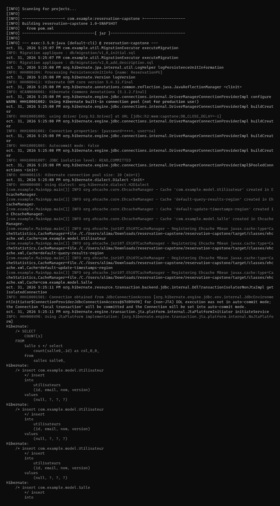
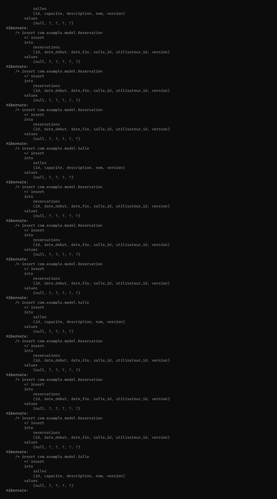
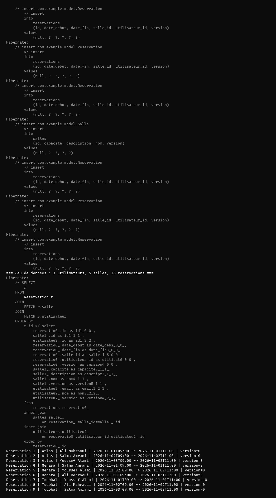
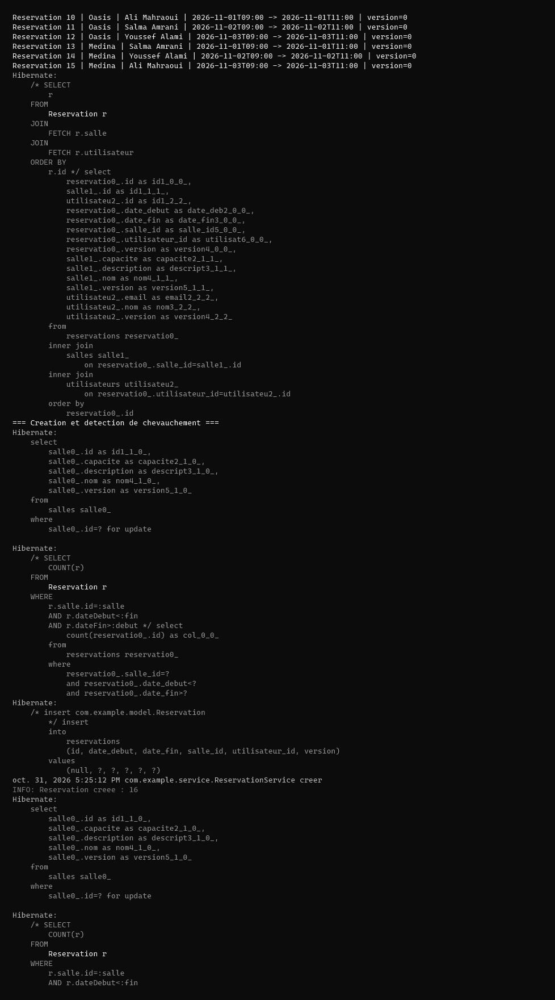
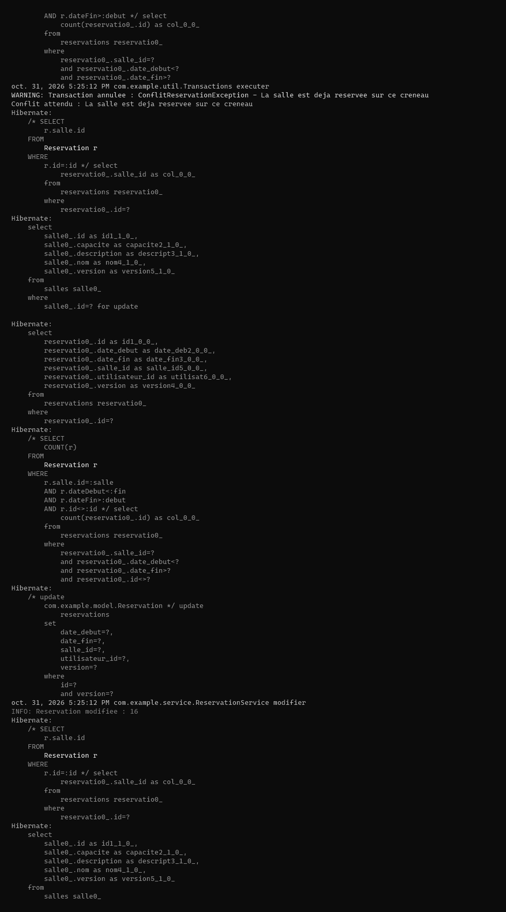
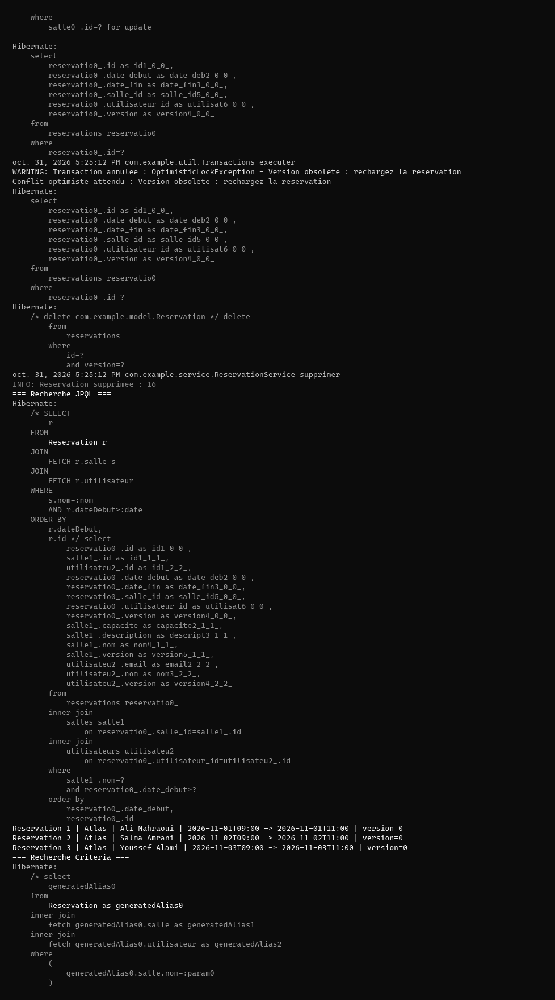
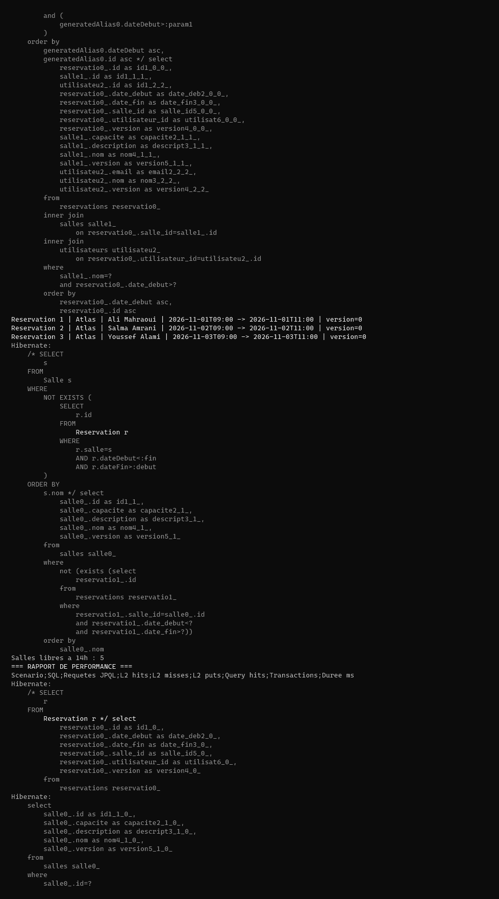
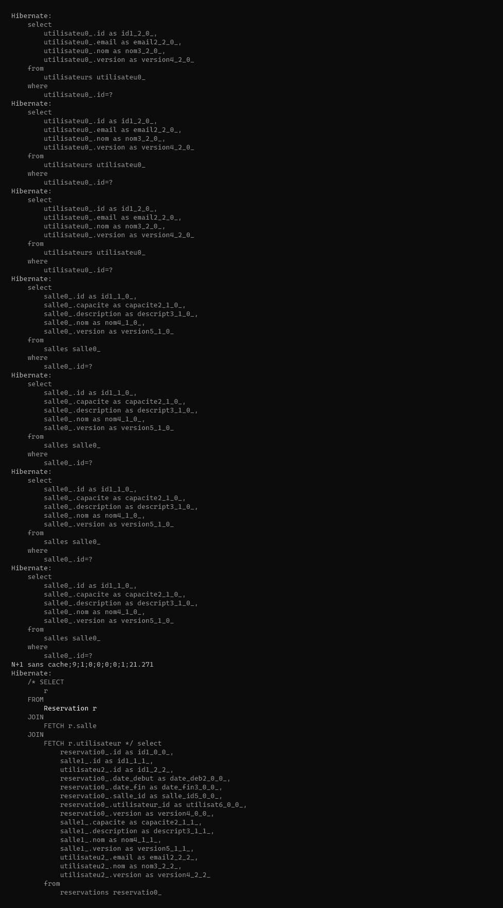
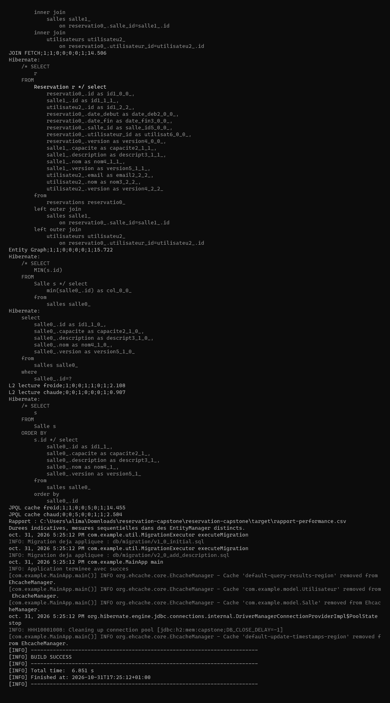

# TP Capstone — Réservation de salles avec JPA et Hibernate

Captures d'exécution régénérées sur cette machine avec la commande `mvn exec:java`.

## Exécution 1

## Exécution 2

## Exécution 3

## Exécution 4

## Exécution 5

## Exécution 6

## Exécution 7

## Exécution 8

## Exécution 9

